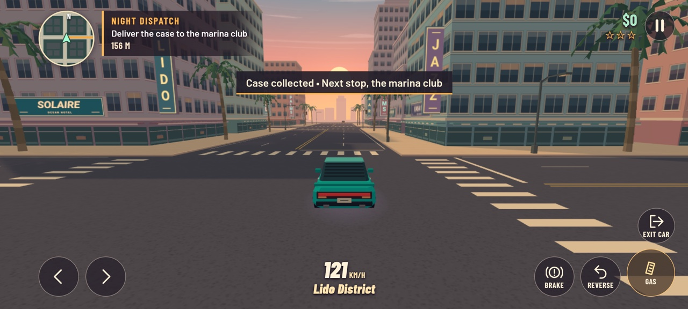

# Sunset Borough

A single-player, offline Android driving game set in a fictional coastal city. Take the teal coupe on a delivery for Lido Records, race through three checkpoints, then pick up a marked car and bring it to the boathouse. After the three jobs you can free-roam or replay the story from the pause menu.



## Play on Android

Download the signed APK from [GitHub Releases](https://github.com/culpen90/sunset-borough/releases/latest) and open it on your Android device. Sunset Borough requires Android 8.0 or newer and an up-to-date Android System WebView. To install version 1.3.0 with Android platform tools, run the following command from your download directory.

```sh
adb install -r Sunset-Borough-1.3.0.apk
```

In landscape, drag the left stick to walk and swipe the street view to look around. While standing still, you can leave the camera at any angle. Walk again and it swings behind your character. Use **Enter car** beside the coupe. Hold **Gas** with your right thumb and steer with your left. Use **Brake** to slow down and **Reverse** to back up. The gold marker and radar route lead to your next objective. Tap the radar for the full city map.

Line up in a lane and tap **Set cruise** to hold your speed and keep the car between the lines. Steer through junctions as usual. The HUD shows **You steer** while you have the wheel. After you release steering for a quarter second, cruise straightens out an early or wide turn and centers the car in the outgoing lane. Steer again at any time to correct it yourself.

Use **− / +** to change the set speed by 5 km/h. Tap **Gap** to leave **1, 2, or 3 car lengths** between your front bumper and the car ahead. The default is 2. Cruise slows for turns and traffic and resumes your set speed when the lane clears. Hold **Gas** for a temporary speed override. Brake, reverse, or tap cruise again to cancel.

Taking an occupied car, hitting traffic at speed, or striking a pedestrian attracts patrols. Break contact to lose your wanted stars. If the patrols catch you, you return to Lido with a fine. Progress saves on mission changes, during play and when paused. **Continue** restores your job, money, vehicle and position on this device.

## Build and test

Open this directory in Android Studio, or use the Gradle wrapper with JDK 17 or newer and Android SDK Platform 36 installed.

```sh
./gradlew :app:assembleDebug :app:lintDebug
node --test tests/*.mjs
```

The debug APK is written to `app/build/outputs/apk/debug/app-debug.apk`. The tests use Node.js 22.7 or newer and exercise the campaign, save compatibility, cruise speed, lane centering, bumper spacing and driver overrides.

Build the release variant with `./gradlew --no-configuration-cache :app:assembleRelease`. Gradle writes the APK to `app/build/outputs/apk/release/`. A fresh clone produces an unsigned release APK. Official downloads use the project’s private signing key.

The game runs from packaged files in Android System WebView. It includes its own 3D city, models, synthesized music and sound effects. If WebGL initialization fails, an overhead renderer uses the same simulation and controls. The application requests no Android permissions.

## Asset credits

The bundled Three.js r160.1 distribution uses the MIT license in [vendor/LICENSE-three.txt](app/src/main/assets/game/vendor/LICENSE-three.txt). Barlow and Barlow Condensed are distributed under the SIL Open Font License in [art/OFL-barlow.txt](app/src/main/assets/game/art/OFL-barlow.txt) and [art/OFL-barlowcondensed.txt](app/src/main/assets/game/art/OFL-barlowcondensed.txt).

<details>
<summary>Title artwork production</summary>

The built-in image generation tool produced the [title illustration](app/src/main/assets/game/art/boulevard.webp) with this prompt.

> Use case: illustration-story. Make the single panoramic 2:1 key art for the title menu of an original cinematic open-world driving game. Sunset on a fictional tropical coastal city's art deco boulevard, with hazy layered skyline, fanning palm silhouettes, overhead wires, long perspective and a large amber setting sun. Hero on the RIGHT SIDE: stylish pearl-turquoise mid-engine 1980s wedge sports coupe with black louvers and dark wheels parked across the right foreground, rear three-quarter view from low camera, narrow red tail lights, detailed reflection on the dark road. A lone figure beside the far side of the car for scale. Limited colors of dusty peach, dark eggplant, faded golden vermilion, petrol teal. Premium hand-painted editorial game cover, bold graphic shadow shapes, beautiful intricate screen print halftone and subtle paper grain. Broad readable silhouettes, striking framing. Keep the entire LEFT 42% dark with shadowed shopfronts and subdued details so large white title typography can be overlaid later. Full bleed, landscape. Absolutely no text, lettering, logos, watermarks, branding or UI.

</details>
